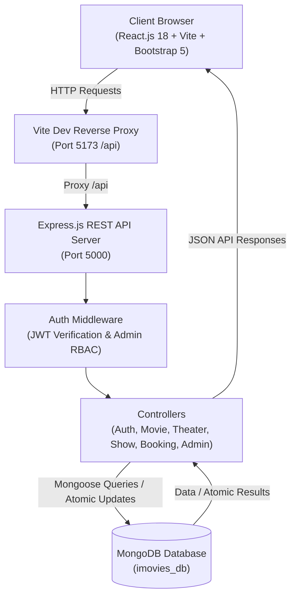
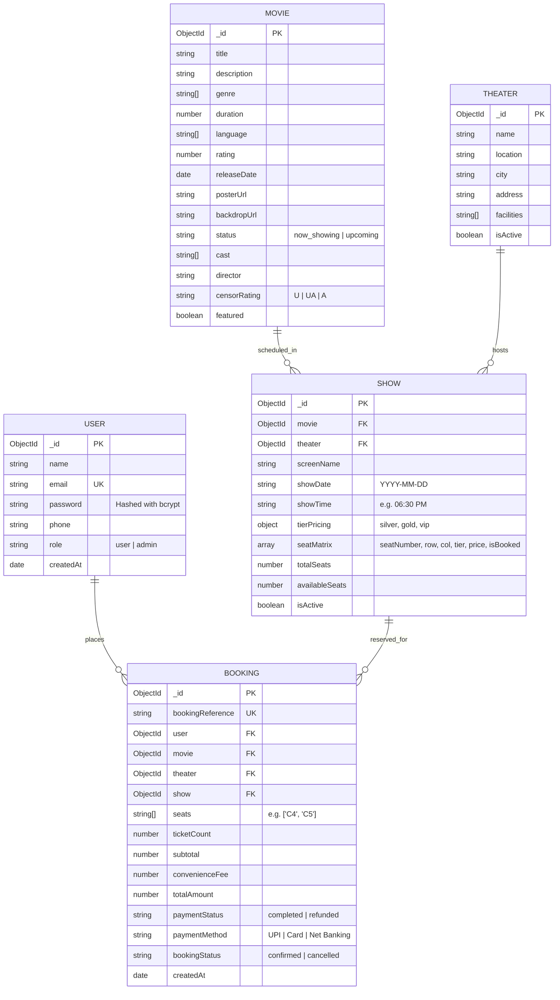

# iMovies — Movie Ticket Booking Made Simple

> **Skill Wallet Individual College Project**  
> A full-stack MERN (MongoDB, Express.js, React.js, Node.js) web application delivering a modern, high-performance cinema ticket booking platform.

---

## 1. Project Overview

**iMovies** is a modern, responsive full-stack movie ticket reservation web application designed to simplify the cinema-going experience. Built using the **MERN** technology stack and styled with a cinematic dark-mode UI, iMovies bridges the gap between cinema audiences and theater multiplexes.

Users can browse trending films, read detailed synopsis and cast information, filter movies by genre and language, explore showtimes across state-of-the-art multiplexes in top cities, interact with an interactive visual seat matrix with tier-based pricing (Silver, Gold, VIP Recliners), and complete ticket purchases using a simulated checkout gateway. The application also provides an Administrative Console for managing the movie catalog, multiplex screens, show schedules, and live customer bookings.

---

## 2. Problem Statement

Traditional cinema ticket counters and legacy booking web interfaces often suffer from:
1. **Inefficient Seat Reservation & Double-Booking**: Weak concurrency control causes race conditions where multiple patrons book the same seat simultaneously.
2. **Cluttered & Inflexible Interfaces**: Non-responsive layouts, overwhelming advertisement banners, and poor visual contrast degrade the booking journey on mobile devices.
3. **Lack of Transparent Pricing**: Inconsistent pricing displays without upfront tier breakdowns (Silver vs Gold vs Recliner) confuse customers prior to payment.
4. **Complex Administration**: Multiplex administrators struggle with fragmented portals to manage movie titles, theater auditoriums, daily show timings, and customer cancellations.

---

## 3. Objectives

- **Deliver an Intuitive UX/UI**: Craft an obsidian cinema-themed dark aesthetic with crimson glowing accents, fluid animations, and mobile-first responsiveness.
- **Implement Concurrency-Safe Seat Locking**: Utilize atomic MongoDB updates to prevent double bookings even under concurrent multi-user load.
- **Role-Based Access Control (RBAC)**: Secure user sessions via JSON Web Tokens (JWT) and Bcrypt password hashing, with strict separation between customer and administrator routes.
- **Full Operational Lifecycle**: Provide complete CRUD functionality for movies, multiplex theaters, showtimes, and booking records.
- **Skill Wallet Alignment**: Satisfy university evaluation criteria with clean MVC backend architecture, detailed ER diagrams, and beginner-friendly setup scripts.

---

## 4. Key Features

### 🌟 Public & Customer Experience
1. **Home Page Showcase**:
   - Hero banner featuring prominent releases with direct "Book Tickets" call-to-action and trailer modal.
   - Interactive search bar with instant genre filter pills (Sci-Fi, Action, Drama, etc.).
   - Distinct sections for **Now Showing** and **Upcoming Releases**.
   - "Why iMovies?" highlights emphasizing instant seat locking, transparent pricing, and M-tickets.
2. **Movie Catalog & Filters**:
   - Filter by title search, genre, language (English, Hindi, Tamil, Telugu), and status.
   - Dynamic movie cards featuring censor ratings (U, UA, A), IMDb star ratings, duration, and genres.
3. **Rich Movie Details**:
   - High-resolution backdrops, cast & director info, detailed synopsis, and format indicators.
4. **Theater & Showtime Explorer**:
   - Group screenings by metro cities (Bengaluru, Mumbai, Delhi NCR, Hyderabad).
   - Date picker tabs (Today, Tomorrow, Day+2, Day+3).
   - Real-time seat availability count and starting prices.
5. **Interactive Cinema Seating Matrix**:
   - Curved ambient cinema screen indicator.
   - Distinct seating categories: **Silver** (Rows A-B), **Gold** (Rows C-F), and **VIP Recliners** (Rows G-H).
   - Clear visual states: *Available*, *Selected* (crimson glow), and *Booked* (disabled).
   - Automatic live calculation of tickets, subtotal, convenience charges, and grand total.
6. **Simulated Payment & Checkout**:
   - Multiple simulated payment options: Instant UPI (GPay/PhonePe), Credit/Debit Card, and Net Banking.
   - Clearly labeled academic sandbox notice (no real financial data or currency is collected).
7. **Digital M-Ticket & Booking Management**:
   - Generation of unique booking reference codes (e.g. `IMV-MVP4U8UG-8I2S`).
   - Printable digital ticket with simulated barcodes, auditorium numbers, and seat lists.
   - Self-service booking cancellation with instant seat release back to the auditorium matrix.
8. **User Profile**:
   - Member tier display ("iMovies Gold Club"), profile details update, and password modification.

### 🛡️ Administrative Console
1. **Admin Dashboard**:
   - Live KPI metric cards: Total Movies, Multiplex Theaters, Scheduled Shows, Total Revenue, and Tickets Sold.
   - Recent transaction audit feed.
2. **Manage Movies**:
   - Add, edit, and delete movie titles with image URLs, metadata, and status toggles.
3. **Manage Theaters**:
   - Register multiplexes, specify city locations, screen capacities, and premium amenities (Dolby Atmos, 4K Laser).
4. **Manage Shows & Screenings**:
   - Associate movies with theaters, configure show dates/times, and set custom tier prices.
   - Automatic generation of the 72-seat layout upon show creation.
5. **Manage Customer Bookings**:
   - Comprehensive audit table of all customer bookings across the platform with filtering and administrative cancellation.

---

## 5. Technology Stack

### Frontend
- **Library/Framework**: React.js 18 (Bootstrapped with Vite 6)
- **Routing**: React Router DOM v6
- **Styling**: Bootstrap 5.3 + Custom Obsidian Cinema CSS (`index.css`)
- **Icons**: React Icons (FontAwesome 5)
- **HTTP Client**: Axios with automatic JWT interceptors

### Backend
- **Runtime Environment**: Node.js (v24.x LTS compatible)
- **Framework**: Express.js 4.x
- **Architecture**: MVC (Model-View-Controller) with RESTful API principles
- **Database ORM**: Mongoose 8.x
- **Authentication**: JSON Web Tokens (`jsonwebtoken`)
- **Password Security**: `bcryptjs` (Salt factor 10)
- **Logging & Middleware**: Morgan (`dev` format), CORS, Dotenv

### Database
- **Database**: MongoDB (Local community server on port 27017 or MongoDB Atlas Cloud)
- **Indexing**: Text index for movie search, compound indexes for fast date/theater show queries

---

## 6. Technical Architecture



---

## 7. Entity-Relationship (ER) Diagram



---

## 8. User Flow

```mermaid
flowchart TD
    Start([User Visits iMovies]) --> BrowseMovies[Browse Now Showing / Trending]
    BrowseMovies --> ViewDetails[Inspect Movie Details & Cast]
    ViewDetails --> SelectTheater[Select Metro City & Multiplex]
    SelectTheater --> PickTime[Select Date & Showtime Slot]
    PickTime --> SeatLayout[Interactive Seating Plan]
    SeatLayout --> ChooseSeats[Select Available Seats (Silver/Gold/VIP)]
    ChooseSeats --> OrderSummary[Review Bill & Convenience Charges]
    OrderSummary --> LoginCheck{Authenticated?}
    LoginCheck -- No --> AuthModal[Sign In or Register]
    AuthModal --> OrderSummary
    LoginCheck -- Yes --> SandboxPay[Simulate Payment (UPI/Card)]
    SandboxPay --> BackendAtomic[Atomic Seat Lock & Reservation API]
    BackendAtomic --> BookingSuccess[M-Ticket Issued with Reference]
    BookingSuccess --> MyBookings[View in Ticket Wallet / Cancel anytime]
```

---

## 9. MVC Pattern Explanation

iMovies strictly adheres to the industry-standard **Model-View-Controller (MVC)** architectural pattern:

1. **Model (`backend/models/`)**:
   - Encapsulates database business logic, schema validation, and constraints using Mongoose.
   - Handles password hashing via pre-save hooks (`User.js`).
   - Represents documents: `User`, `Movie`, `Theater`, `Show`, and `Booking`.
2. **View (`frontend/src/`)**:
   - Implemented as a decoupled Single Page Application (SPA) in React.js.
   - Renders interactive UI components, manages local state, and interacts with the Controller via asynchronous HTTP REST calls.
3. **Controller (`backend/controllers/`)**:
   - Intermediary layer handling HTTP requests, input validation, and business logic.
   - Executes atomic database operations (such as seat reservation and cancellation) and returns standardized JSON responses.

---

## 10. Project Folder Structure

```
iMovies/
├── backend/
│   ├── config/
│   │   └── db.js                 # MongoDB connection logic
│   ├── controllers/
│   │   ├── authController.js     # User registration, login, profile updates
│   │   ├── movieController.js    # Movie CRUD & search queries
│   │   ├── theaterController.js  # Theater CRUD & city filters
│   │   ├── showController.js     # Show scheduling & seat matrix generation
│   │   ├── bookingController.js  # Atomic seat booking & cancellation
│   │   └── adminController.js    # KPI statistics & audit feeds
│   ├── middleware/
│   │   ├── authMiddleware.js     # JWT verification & RBAC check
│   │   └── errorMiddleware.js    # Centralized JSON error handler
│   ├── models/
│   │   ├── User.js               # User schema with bcrypt
│   │   ├── Movie.js              # Movie catalog schema with text index
│   │   ├── Theater.js            # Multiplex & screen schema
│   │   ├── Show.js               # Showtimes & seat matrix schema
│   │   └── Booking.js            # Booking records & references
│   ├── routes/
│   │   ├── authRoutes.js         # /api/auth
│   │   ├── movieRoutes.js        # /api/movies
│   │   ├── theaterRoutes.js      # /api/theaters
│   │   ├── showRoutes.js         # /api/shows
│   │   ├── bookingRoutes.js      # /api/bookings
│   │   └── adminRoutes.js        # /api/admin
│   ├── scripts/
│   │   └── seed.js               # Database population script
│   ├── utils/
│   │   └── generateToken.js      # JWT signing utility
│   ├── .env                      # Active backend environment variables
│   ├── .env.example              # Template environment variables
│   ├── package.json              # Backend dependencies
│   └── server.js                 # Express server entry point
│
├── frontend/
│   ├── public/                   # Static assets
│   ├── src/
│   │   ├── assets/               # Brand illustrations & fallback posters
│   │   ├── components/           # Navbar, Footer, MovieCard, Spinner, Guards
│   │   ├── context/
│   │   │   └── AuthContext.jsx   # Global session state & helper methods
│   │   ├── layouts/
│   │   │   ├── MainLayout.jsx    # Standard customer layout
│   │   │   └── AdminLayout.jsx   # Side-navigation layout for admin
│   │   ├── pages/
│   │   │   ├── HomePage.jsx               # Page 1: Hero & Trending showcase
│   │   │   ├── AllMoviesPage.jsx          # Page 2: Filterable movie catalog
│   │   │   ├── MovieDetailsPage.jsx       # Page 3: Movie synopsis & cast
│   │   │   ├── TheaterSelectionPage.jsx   # Page 4: City & theater selector
│   │   │   ├── ShowtimeSelectionPage.jsx  # Page 5: Date & time slot picker
│   │   │   ├── SeatSelectionPage.jsx      # Page 6: Interactive seat matrix
│   │   │   ├── BookingSummaryPage.jsx     # Page 7: Review & payment sandbox
│   │   │   ├── LoginPage.jsx              # Page 8: Customer sign-in
│   │   │   ├── RegisterPage.jsx           # Page 9: Account creation
│   │   │   ├── MyBookingsPage.jsx         # Page 10: Ticket history & cancel
│   │   │   ├── UserProfilePage.jsx        # Page 11: Member profile details
│   │   │   ├── AdminLoginPage.jsx         # Page 12: Admin gateway
│   │   │   ├── AdminDashboardPage.jsx     # Page 13: KPI dashboard
│   │   │   ├── AdminMoviesPage.jsx        # Page 14: Movie management
│   │   │   ├── AdminTheatersPage.jsx      # Page 15: Theater management
│   │   │   ├── AdminShowsPage.jsx         # Page 16: Show scheduling
│   │   │   ├── AdminBookingsPage.jsx      # Page 17: Platform booking audit
│   │   │   └── NotFoundPage.jsx           # Page 18: 404 Error page
│   │   ├── services/             # Axios API service callers
│   │   ├── App.jsx               # Route definitions
│   │   ├── index.css             # Cinematic obsidian theme stylesheet
│   │   └── main.jsx              # React DOM mounting
│   ├── .env                      # Active frontend configuration
│   ├── .env.example              # Template frontend configuration
│   ├── index.html                # HTML5 root with Google Fonts
│   ├── package.json              # Frontend dependencies
│   └── vite.config.js            # Vite configuration with /api reverse proxy
│
├── .gitignore                    # Git exclusions
├── package.json                  # Root npm workspace script runner
└── README.md                     # Complete project documentation
```

---

## 11. Software Requirements

- **Operating System**: Windows 10/11, macOS, or Ubuntu Linux
- **Node.js**: Version 18.x, 20.x, or 24.x LTS
- **npm**: Version 9.x or higher
- **MongoDB**: Local Community Server (v6.0+) running on port 27017 **OR** MongoDB Atlas Cloud cluster
- **Web Browser**: Modern Chromium or WebKit browser (Chrome, Edge, Firefox, Brave)

---

## 12. Step-by-Step Installation & Setup

### Step 1: Clone or Navigate to Project
```bash
cd C:\Users\hp\.gemini\antigravity\scratch\iMovies
```

### Step 2: Install Backend Dependencies
```bash
cd backend
npm.cmd install
```

### Step 3: Configure Backend Environment Variables
Create or verify `backend/.env`:
```env
PORT=5000
NODE_ENV=development
MONGO_URI=mongodb://127.0.0.1:27017/imovies_db
JWT_SECRET=imovies_super_secret_jwt_key_skillwallet_2026
JWT_EXPIRE=7d
CLIENT_URL=http://localhost:5173
ADMIN_EMAIL=admin@imovies.com
ADMIN_PASSWORD=Admin@123456
```

### Step 4: Populate Database (Seed Sample Data)
Run the automated seed script to populate realistic movies, multiplex theaters, showtimes, customer accounts, and demo bookings:
```bash
node scripts/seed.js
```
*Expected Output: `SUCCESS! Database seeded with rich movies, theaters, shows, and users.`*

### Step 5: Install Frontend Dependencies
```bash
cd ../frontend
npm.cmd install
```

### Step 6: Configure Frontend Environment Variables
Verify `frontend/.env`:
```env
VITE_API_BASE_URL=/api
```

---

## 13. Running the Application

### Running the Backend
From the `backend/` directory:
```bash
npm.cmd start
```
The server will start on port `5000` and connect to MongoDB:
```
[iMovies Backend] Server running in development mode on port 5000
[iMovies Backend] MongoDB Connected: 127.0.0.1/imovies_db
```

### Running the Frontend
From the `frontend/` directory in a new terminal:
```bash
npm.cmd run dev
```
Vite will start the client on:
```
➜  Local:   http://127.0.0.1:5173/
```

Open `http://localhost:5173` in your web browser.

---

## 14. Demo Credentials for Evaluation

For rapid demonstration during university evaluation, pre-configured accounts are available:

| Account Type | Email | Password | Access Level |
|---|---|---|---|
| **Administrator** | `admin@imovies.com` | `Admin@123456` | Master access to `/admin/dashboard` |
| **Customer User** | `rahul@gmail.com` | `User@123456` | Standard booking, tickets, and profile |

*Both login screens feature 1-click **"Auto-Fill Demo Credentials"** buttons for evaluator convenience.*

---

## 15. REST API Documentation

### Authentication (`/api/auth`)
| Method | Endpoint | Description | Access |
|---|---|---|---|
| `POST` | `/api/auth/register` | Register customer account | Public |
| `POST` | `/api/auth/login` | Login and obtain JWT token | Public |
| `GET` | `/api/auth/profile` | Get current user profile | Private |
| `PUT` | `/api/auth/profile` | Update profile / password | Private |

### Movies (`/api/movies`)
| Method | Endpoint | Description | Access |
|---|---|---|---|
| `GET` | `/api/movies` | Get movies (filters: search, genre, lang, status) | Public |
| `GET` | `/api/movies/:id` | Get single movie details + show count | Public |
| `POST` | `/api/movies` | Create a new movie | Admin |
| `PUT` | `/api/movies/:id` | Update movie details | Admin |
| `DELETE` | `/api/movies/:id` | Delete movie & associated shows | Admin |

### Theaters (`/api/theaters`)
| Method | Endpoint | Description | Access |
|---|---|---|---|
| `GET` | `/api/theaters` | Get theaters (filters: city, search) | Public |
| `GET` | `/api/theaters/:id` | Get single theater info | Public |
| `POST` | `/api/theaters` | Create new multiplex | Admin |
| `PUT` | `/api/theaters/:id` | Update multiplex details | Admin |
| `DELETE` | `/api/theaters/:id` | Delete multiplex & shows | Admin |

### Shows (`/api/shows`)
| Method | Endpoint | Description | Access |
|---|---|---|---|
| `GET` | `/api/shows` | Get shows (filters: movie, theater, showDate, city) | Public |
| `GET` | `/api/shows/:id` | Get single show with full seat matrix | Public |
| `POST` | `/api/shows` | Schedule show & generate seats | Admin |
| `PUT` | `/api/shows/:id` | Update show timing / active status | Admin |
| `DELETE` | `/api/shows/:id` | Delete scheduled show | Admin |

### Bookings (`/api/bookings`)
| Method | Endpoint | Description | Access |
|---|---|---|---|
| `POST` | `/api/bookings` | Concurrency-safe atomic seat booking | Private |
| `GET` | `/api/bookings/my-bookings` | Retrieve user's booking history | Private |
| `GET` | `/api/bookings/:id` | Get single booking receipt | Private |
| `PUT` | `/api/bookings/:id/cancel` | Cancel booking & release seats | Private |

### Admin Operations (`/api/admin`)
| Method | Endpoint | Description | Access |
|---|---|---|---|
| `GET` | `/api/admin/dashboard-stats` | Get KPI metrics and recent audit log | Admin |
| `GET` | `/api/admin/bookings` | List all system bookings with filters | Admin |

---

## 16. Verification & Test Cases

The application includes automated and manual end-to-end verification:

| # | Test Scenario | Steps Executed | Expected Result | Result |
|---|---|---|---|---|
| 1 | **Database Seeding** | Ran `node scripts/seed.js` | Dropped old tables, seeded 8 movies, 6 theaters, 288 shows, users | **PASS** |
| 2 | **Server Health** | `GET /api/health` | Returned HTTP 200 with status: ok | **PASS** |
| 3 | **Customer Login** | `POST /api/auth/login` with `rahul@gmail.com` | Returned JWT and user profile | **PASS** |
| 4 | **Movie Catalog Filter** | `GET /api/movies?status=now_showing` | Returned 6 active movies | **PASS** |
| 5 | **Seat Reservation** | `POST /api/bookings` with seats `A3, A4` | Booking created, reference issued, seats locked | **PASS** |
| 6 | **Double-Booking Prevention** | Attempted booking `A3` again | Server returned HTTP 409 Conflict with seat lock warning | **PASS** |
| 7 | **Ticket Cancellation** | `PUT /api/bookings/:id/cancel` | Status marked cancelled, seats released to `isBooked: false` | **PASS** |
| 8 | **Admin Protection** | Attempted admin route with regular token | Server blocked with HTTP 403 Forbidden | **PASS** |
| 9 | **Production Bundle** | Executed `npm run build` | Built 128 modules in 2.21s with 0 errors | **PASS** |

---

## 17. Skill Wallet Specific Sections

### 1. Technical Architecture
The application employs a 3-tier decoupled client-server architecture:
- **Presentation Tier**: React 18 SPA compiled using Vite, managing asynchronous state via Context API and rendering responsive Bootstrap components.
- **Application Tier**: Node.js and Express.js REST server applying centralized middleware for CORS, JWT validation, and schema checking.
- **Data Tier**: MongoDB document database ensuring ACID-compliant document updates for seat locks and JSON document storage.

### 2. Roles & Responsibilities
- **Guest / Public**: Browse movies, inspect trailers and cast, filter by genre, check theater schedules and seating plans.
- **Registered Customer**: Select and lock seats, simulate payments, obtain digital M-tickets, review booking history, cancel tickets, and manage profile information.
- **Cinema Administrator**: Master dashboard visibility into box office revenue and ticket volumes, full CRUD over the movie catalog, multiplex screens, daily show schedules, and customer bookings.

### 3. Concurrency-Safe Booking Logic
To guarantee that two users viewing the seating plan simultaneously cannot purchase the same seat, iMovies utilizes MongoDB's atomic document updates:
```javascript
const result = await Show.findOneAndUpdate(
  {
    _id: showId,
    seatMatrix: {
      $not: {
        $elemMatch: {
          seatNumber: { $in: selectedSeats },
          isBooked: true
        }
      }
    }
  },
  {
    $set: { /* mark matching seats as booked */ },
    $inc: { availableSeats: -selectedSeats.length }
  },
  { new: true }
);
```
If `result` is null, a race condition occurred and the backend returns an explicit `HTTP 409 Conflict`, prompting the second user to choose alternative seats.

---

## 18. Deployment Guide

### Deploying the Backend on Render
1. Create a free account at [render.com](https://render.com).
2. Connect your Git repository.
3. Select **Web Service** with:
   - **Root Directory**: `backend`
   - **Build Command**: `npm install`
   - **Start Command**: `node server.js`
4. Set Environment Variables in Render:
   - `MONGO_URI`: Your MongoDB Atlas connection string
   - `JWT_SECRET`: A secure random secret string
   - `CLIENT_URL`: Your Vercel frontend URL
   - `NODE_ENV`: `production`

### Deploying the Frontend on Vercel
1. Create an account at [vercel.com](https://vercel.com).
2. Import the Git repository.
3. Set **Root Directory** to `frontend`.
4. Configure Environment Variable:
   - `VITE_API_BASE_URL`: `https://your-backend-app.onrender.com/api`
5. Deploy. Vercel automatically runs `vite build` and deploys the static single-page app.

---

## 19. Future Enhancements

- **Real Payment Gateway Integration**: Razorpay / Stripe integration for live currency collection.
- **Snacks & Concessions Add-ons**: Add popcorn, beverages, and combo meals during checkout.
- **Interactive Theater Map**: GPS-based theater locator with distance calculation.
- **SMS & WhatsApp Ticket Delivery**: Send automated booking confirmation links via Twilio / WhatsApp Cloud API.

---

## 20. Conclusion

**iMovies — Movie Ticket Booking Made Simple** successfully delivers an individual university project that meets real-world software engineering standards. Combining an attractive cinema UI, robust concurrency safety, secure role-based access, and transparent architecture, it demonstrates comprehensive mastery of full-stack MERN development.
